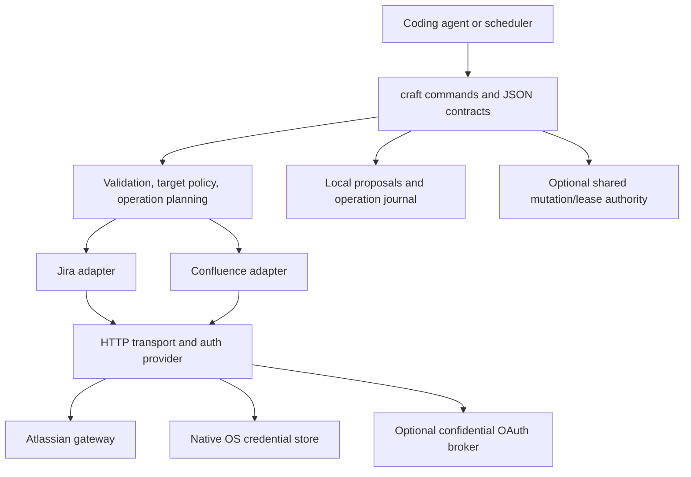

# Craft implementation plan: cloud CLI, initially Jira and Confluence

Implementation sequencing and Rust placement are now owned by the [Craft subproject plan](../../cli/README.md), its [OpenSpec design](../../cli/openspec/changes/build-cloud-cli/design.md) and [detailed tasks](../../cli/openspec/changes/build-cloud-cli/tasks.md). The milestone overview below is historical planning context. Do not use its labels in code, comments, tests or commit subjects; follow the [project coding standard](../../cli/docs/coding-standard.md).

Status: proposed design, extended 9 November 2026, ready for implementation after the capability spikes below. Selected project name: **Craft**. Executable: **`craft`**. This work delivers research and a detailed plan, not a functioning binary. See the [research](../researches/atlassian-agent-cli-research.md), [48 primary references](../researches/atlassian-agent-cli-sources.md), [command/data contract](atlassian-agent-cli-contract.md), [API-backed command catalog](cloud-cli-command-catalog.md), and [provider architecture](cloud-cli-provider-architecture.md).

The [agent interface requirements](agent-cli-efficiency-and-skills.md), supported by [18 agent-interface source references](../researches/agent-cli-and-skills-research.md), define token efficiency, invalid-input resistance, progressive skills and end-to-end evaluation. The [list/cursor/response-schema contract](list-paging-and-response-schema.md) specifies pagination and selected-field retrieval.

## 1. Intended result

A coding agent can invoke a cross-platform cloud CLI to discover context, create/update/delete resources, manage attachments/comments/status, prepare design and task-plan proposals, and apply authorized changes. Jira and Confluence are the initial providers; Bitbucket, Trello, and other systems are planned extensions. Tokens and client credentials remain inside the CLI's authentication subsystem and native OS credential store. Ordinary commands never launch login prompts, an editor, a pager, or a browser.

The primary workflow is **create a normal Confluence page with all proposed tasks → human review and edits → approve a particular page revision → create Jira tickets from that revision → record ticket mappings**. A plan draft is a review state, not Confluence's unpublished content lifecycle. Local files are staging inputs and snapshots; after page creation, the review page is authoritative for the plan.

An administrator or human initializes authentication. Agents subsequently use the authorized profile. Both delegated-user OAuth and service-account OAuth are planned, with different provisioning and token lifecycles. Cloud is the researched target; Data Center is a distinct future adapter, not silently treated as compatible.

### Requirements and proof

| Requirement | Planned implementation | Evidence required before release |
| --- | --- | --- |
| Agent-facing CLI | Versioned JSON schema, explicit commands, bounded output, stable errors | Black-box subprocess tests and an agent task walkthrough |
| Jira task ledger | Read/search, metadata, issue proposals, writes, transitions, progress notes, dependencies | Sandbox task lifecycle and project-specific field validation |
| Confluence designs | Read/search, design templates, normal shared review-page creation/update | Rich-content round trips, human edits and second-person review access |
| Task planning drafts | Full task graph on a shared Confluence page, then approval-bound ticket creation | Human-edited page import, approval/version checks, DAG validation and partial-apply recovery |
| OAuth | Separate service and delegated auth providers | Real token acquisition and API access for both products in each supported mode |
| Login/logout lifecycle | Explicit provisioning/login, status, refresh/check, local logout, revocation guidance | Expiry, revocation, locked store, concurrency, and deletion tests |
| Windows/Linux/macOS keyring | Explicit persistent native backend per OS | Real store/retrieve/rotate/delete tests on each supported platform |
| Multi-human use | Shared remote records; requester, executor, reviewer are distinct | Review handoff preserving identity and revision |
| Multi-machine use | Independent machine credentials and serialized shared mutations | Two-worker conflict and duplicate-attempt tests before enabling parallel writes |
| General resource operations | Typed issue/page/comment/attachment operations, space creation, status semantics and optional admin bundles | API/scope matrix, lifecycle/binary/async sandbox evidence; no invented universal CRUD |
| Provider extension | Shared core, provider descriptors/modules, factory workflows above resource CRUD | A future provider passes conformance without changing core contracts or weakening auth/storage |
| Token efficiency and input correctness | Compact projections/receipts, bounded discovery, strict structural/semantic checks, short skill with conditional references | Zero-network malformed-input fixtures; no mutation on prohibited semantic cases; paired task/token/correctness evaluations |

## 2. Boundaries and implementation choices

Use **Rust**, `clap` for parsing, `serde` for typed data, and an HTTP client such as `reqwest`. Prefer a blocking request model initially: a CLI invocation usually performs a bounded sequence, so an asynchronous framework is not required. Pin compatible versions and minimum Rust version after the spike. These are proposed dependencies, not installed packages.

Use `keyring-core` with explicitly selected native stores, rather than relying on a library's implicit default/fallback chain. Current package behavior and platform constraints are summarized in the research. Backend crate names/versions, licensing, maintenance, native build requirements, and prompt behavior are a milestone deliverable.

Do not add an LLM SDK to the CLI. A coding agent creates prose and plans, then passes files to deterministic commands. Ship an agent skill explaining discovery, proposal generation, checks, apply, and recovery. A future MCP wrapper can call the same library; it must not create a second implementation of auth and mutation semantics.

Keep the CLI separate from a continuously running scheduler. It can expose operations to a scheduler, but a shell process that finishes a command is not a durable task runner. Provider namespaces preserve native resources; common JSON/auth/transport/journal behavior is shared. The provider architecture extends the initially Atlassian-only structure below and is authoritative for extension boundaries.

## 3. Architecture



The text path is: parse input, resolve a trusted profile and target, validate capability/policy, prepare or apply an operation, authenticate inside the transport, and return a bounded structured result. The local journal contains non-secret operation records. Native credential storage contains secrets. The broker is needed for the chosen delegated-user distribution design, not for service-account client credentials.

Suggested code modules:

```text
crates/craft/src/main.rs
crates/craft-core/src/contracts/
crates/craft-core/src/auth/
crates/craft-core/src/secrets/
crates/craft-core/src/transport/
crates/craft-core/src/jira/
crates/craft-core/src/confluence/
crates/craft-core/src/documents/
crates/craft-core/src/plans/
crates/craft-core/src/journal/
crates/craft-core/src/policy/
schemas/
skills/craft-cloud/
tests/contract/
tests/security/
tests/platform/
tests/sandbox/
```

Keep a thin binary and shared core initially, with separate provider and workflow modules. Extract provider/workflow crates when useful, following the companion architecture. Add a broker service project only when delegated login is implemented. No directories above have been created by this plan. The diagram's gateway and broker describe Jira/Confluence; later providers supply their own trusted routing/auth strategies.

## 4. Authentication design

### A. Service-account mode for unattended work

An administrator checks eligibility and grants a dedicated service identity only the required product/project/space access. Provision its client ID and secret through an OS-backed secure prompt or trusted provisioning pipe into the keyring. Do not put the secret in arguments, environment files, repository configuration, or agent prompts.

`auth login --mode service` sends a form-encoded request to `https://auth.atlassian.com/oauth/token` with `grant_type=client_credentials`, `client_id`, and `client_secret`. It verifies the configured sites and effective access, and commits a valid credential generation to the store. Use the returned `expires_in` rather than hard-coding lifetime. When the token approaches expiry, acquire another token using that credential. There is no 3LO refresh token in this mode.

Provisioning and login are separate: provisioning installs long-lived credential material; login validates it and creates an authenticated session/cache. A read-only profile is useful for discovery, but a privileged OAuth token is not made read-only merely by giving it a profile name. Product permissions and credential scope must support the separation.

### B. Delegated-user browser login

Use one organization-owned 3LO app and an organization-operated confidential broker. The Atlassian app secret stays in server secret storage, never in the binary or local agent environment. Request only the product capabilities required, with offline access if persistent user sessions are needed.

Proposed sequence:

1. A human explicitly runs `auth login --mode user --interactive` in a trusted terminal. Ordinary agent commands cannot initiate it implicitly.
2. The CLI creates an authenticated broker login transaction with a random local binding secret or proof key. The browser URL carries no provider tokens or retrieval credential.
3. The broker authenticates the organization user, binds the transaction to that user and allowed organization/sites, and begins Atlassian authorization with unpredictable state and a registered HTTPS callback.
4. The broker validates the callback and exchanges the code as the confidential client. Do not assume Atlassian supports arbitrary loopback redirects or public-client PKCE.
5. The CLI retrieves the resulting token bundle once over TLS, proving possession of the transaction binding. Browser completion alone must not let a different CLI redeem the bundle.
6. The CLI persists the bundle in its local native store and acknowledges completion. Pending broker token material expires and is deleted. Disable token/callback-body logging at application, proxy, and telemetry layers.
7. Later token refresh goes through a narrowly authenticated broker operation that uses the app secret server-side. Bind the request to its installation/actor, app, expected scope and sites; do not expose an anonymous generic token-exchange service.

The broker may transiently process provider tokens. This trust boundary must be disclosed and reviewed. Keep persistent provider token storage local for this design; server-side app secrets and installation authentication are separate. If the organization's desired broker cannot meet the token-handoff requirements, stop this mode until its storage and security design is revised explicitly.

This broker is not Atlassian's device-code grant. A no-browser option can display a broker login URL for the human, while the CLI continues its bound transaction. It must not require copying refresh tokens through chat.

### Grant ownership and lifecycle

Use a credential/grant identifier separate from a site profile. Jira and Confluence profiles sharing the same grant must share its refresh lock. Never copy a rotating refresh-token chain to other machines. Verify how new consents and installs affect existing grants; do not promise independent refresh chains merely because two local profile names differ. Prefer separate service credentials for multi-machine execution. If simultaneous delegated ownership cannot be established safely, restrict that mode to one active refresh owner per grant.

Refresh sequence: acquire OS cross-process lock, reread committed generation, recheck expiry, exchange once, write/verify a new generation, commit its active pointer, then release. Use timeouts for lock acquisition and an expiry safety margin. Return reauthentication-required for an invalid grant; do not loop login or indiscriminately retry token exchanges. A network loss after rotation or a keyring write failure may require bounded recovery or new authorization. Record no secret material in that recovery journal.

`auth status` reports mode, actor, cloud IDs, scopes, expiry, and keyring health without tokens. Its default is local inspection; `--verify` checks remote access and reports per-product results. `auth refresh` allows explicit diagnosis but normal calls refresh automatically.

### Logout and revocation

Local logout acquires the same credential lock, marks the credential logged out, removes every token/secret generation and local auth transaction belonging to that profile/credential, and reports cleanup failures. Profiles sharing a grant require explicit affected-profile reporting. Repeated logout is idempotent. Unrelated profiles remain intact.

Removing a local credential does not revoke the provider's grant, credentials on another machine, or an already in-flight request. Provide `auth revoke-info` with the correct mode-specific administrative/account steps. Implement remote revocation only if a documented, tested endpoint is established; do not invent a `/revoke` call. Service credentials can be revoked through the documented admin interface.

## 5. Native secret storage

| Platform | Required backend | Acceptance concern |
| --- | --- | --- |
| Windows | Credential Manager native API under intended OS principal | Variable token size, persistence, session identity, binary update behavior |
| macOS | Keychain native API | Access controls, signing identity, locked keychain, unattended access after install/update |
| Linux | Persistent Secret Service via session D-Bus | Available service/collection, locked vault, desktop versus headless session |

No transparent plaintext or encrypted-file fallback: the explicit requirement is local keyring storage. No secrets on stdout/stderr, clipboard, shell history, subprocess arguments, crash reports, debug traces, or operation artifacts. Secure stdin provisioning is for a trusted bootstrapper, not a way to ask the LLM to print a credential.

Use opaque credential IDs in key names. Store expiry and actor metadata separately from secret bytes where useful. Prefer separate values for client secret, access token, refresh token, and broker installation credential, but support values larger than a single backend item.

For Windows-size portability, implement bounded keyring-only chunking: write all chunks under a new generation, verify their count/length/digest, then commit a small active-generation record in the keyring. Readers hold the credential lock and reject missing/inconsistent generations. Old generations are removed after commit; interrupted generations are reconciled on the next operation. Verify that replacing the pointer has sufficient native semantics; do not claim a cross-item transaction. Byte limits apply after the chosen encoding. Never truncate tokens.

Headless Linux/cloud agents need a provisioned persistent vault under the runner user and an established noninteractive unlock procedure. Fail with `KEYRING_UNAVAILABLE` or `KEYRING_LOCKED` otherwise. Windows services and remote macOS users also need their own tested principal/session setup. Do not assume desktop credentials follow a container, WSL environment, or different login user.

The native store protects storage at rest. It does not isolate credentials from malicious code running with sufficient access as the same OS user. If the agent executes untrusted repository code, run that code in an isolated environment without keyring access; use a narrow host-side tool service where needed. Local CLI policy is a usability guard, not an independent security boundary against a hostile same-user process.

## 6. Jira task ledger

Configure project keys/IDs, allowed issue types, field mappings, work states, transition IDs, dependency link types, and default ownership. Discover required create/edit fields and account IDs rather than guessing names or assuming every project uses Epic/Story/Subtask identically.

A task proposal contains a stable client task ID, title, description, acceptance criteria, repository scope, dependencies, spec/design links, parent work item, requester, and agent run reference. Applying a proposal creates real issues. Progress updates use a deliberate run note/comment strategy rather than rewriting human descriptions on every step.

Expose general `jira issue create` under configured authorization as well as the reviewed-plan workflow. Approval-bound plan materialization must use `plan tickets-create`; its gate is not a global prohibition on issue creation. Mandatory project-wide plan provenance needs enforcement outside a bypassable local client.

Jira remains authoritative for shared business state; the local journal records attempts and remote IDs. Use namespaced non-secret correlation properties where appropriate, but do not depend on 3LO being able to declare them searchable in JQL. For recovery, known remote IDs and an approved searchable correlation field/label or coordinator registry are more reliable than assuming property indexing.

Do not expose `claim` as a guaranteed distributed lock in standalone mode. A two-step read and update is race-prone, even if the issue looks unchanged during preflight. For multiple writers, serialize mutations through the coordinator/lease authority, including create-plan application and guarded transitions. If no authority is configured, explicitly report advisory consistency and support only a declared single-writer deployment. Do not silently use a local SQLite database as a cross-machine lock.

Preflight fingerprints help identify stale work but do not create atomic compare-and-swap in Jira. Scope update commands to particular fields, inspect current values, and preserve unknown fields. Conflicting or externally edited tasks return a structured conflict where detectable. Do not fabricate a universal Jira issue-version precondition.

## 7. Confluence-first planning and human review

Provide deterministic design scaffolds for context/problem, goals/non-goals, current system, alternatives/decision, high-level design, detailed interfaces/data/failures, security, testing, rollout/recovery, open questions, and linked tasks. A small change can use a shorter template. The agent supplies the substantive analysis.

The agent assembles the design and task breakdown locally, then creates a normal published Confluence page for human review. Include the complete proposed tasks, acceptance criteria, dependencies, intended Jira project/type, repository scope, and design references. Set the visible review state to Proposed or In review. No Jira tickets are created at this stage, and publication is not plan approval. Unpublished Confluence drafts are outside this requirement.

Use a documented Markdown subset and an AST-based renderer. Escape storage-format markup, validate links and code blocks, and reject unsupported macros/attachments instead of silently losing content. Jira descriptions render to ADF. Advanced existing Confluence pages can be retrieved in raw structured format; never claim lossless arbitrary-page Markdown editing.

Use human-readable, parseable task sections with stable IDs visible in the page. The renderer and parser share a schema. Human changes to titles, acceptance criteria, dependencies, exclusions, and estimates must be read back from the page. Hidden JSON or an original local file must not override the reviewed visible content. Unsupported/ambiguous edits return a precise parsing error and require repair of the page.

Page updates take an expected version and source-body digest. Fetch current content, detect divergence, and surface conflicts without force-overwrite retries. Preserve human edits and editor drafts. A sandbox test must prove a second person can review/edit the page and the CLI imports those changes correctly.

### Review completion and ticket creation

After discussion, capture explicit human approval of a page ID, version, and content digest. A small first implementation can use an explicitly referenced footer comment by an authorized reviewer, naming the plan revision and digest. Verify the comment's page association, current content, author/edit metadata, and reviewer eligibility through the API. A comment generated by the agent or a self-written Approved field is insufficient. Sites with established approval tooling can supply a trusted approval adapter instead.

The CLI does not impersonate a reviewer or automatically resolve human comments. Eligibility and whether unresolved review requests block creation are configured policy. Verify revocation/edited-comment handling; do not infer approval from prose sentiment or a resolved-comment count. Use a distinct executing service identity if independence from the reviewing human is required.

`plan tickets-preview` imports the specified current page, validates its graph and Jira metadata, and builds a mutation manifest. `plan tickets-create --apply` checks approval and expected revision again, then creates tickets in dependency/hierarchy order and records every stable task-ID-to-issue mapping. Do not substitute an unreviewed local plan at this point.

Recheck the page and approval between batches. An edit before creation blocks it; an edit during creation stops subsequent batches, returns the partial mapping, and requires a new approval/reconciliation. There is no atomic transaction across Confluence and Jira. Serialize competing creators through the mutation authority and key operation identity to the source revision.

Rechecking cannot eliminate the interval between a page read and an issue write. If the team requires the page to remain frozen throughout materialization, add verified page-edit restrictions or an established workflow freeze for the approved version. Otherwise apply the explicitly recorded approved snapshot and stop when a later change is observed; do not claim atomic invalidation across products.

Record results in a separate linked result page or explicit comment so ticket creation does not rewrite the approved task specification mid-run. Each ticket links to the source page and approved revision. Resuming the same operation reuses confirmed mappings. Amended plans produce a reviewed delta; they do not blindly recreate all tickets or automatically delete tasks removed from the page.

## 8. Mutation safety and recovery

All remote mutations require explicit apply intent. Local validate/render/diff operations have no remote writes; remote preflight reads are disclosed. Service policies can authorize routine task updates without asking humans repeatedly. Ticket creation from a plan requires the reviewed source revision and trusted approval evidence. Configure all issue-create entry points to enforce that policy so a low-level command cannot bypass the plan gate. A boolean or text field that the agent wrote itself is not proof of human approval.

Before a mutation, persist a journal entry containing operation ID, input digest, target provider/tenant/object, actor, attempt and expected preconditions. Store received IDs immediately. Local request states include `prepared`, `sent`, `confirmed`, `failed`, and `unknown`; a plan has per-step states and dependency mappings. An asynchronously accepted request also retains a remote job handle and a separate accepted/running/succeeded/failed/unknown job state. Confirmed submission is not confirmed completion.

Reuse of an operation ID with different content is an error. A local journal provides replay protection only for that installation. A shared mutation authority is required for cross-machine deduplication; correlation markers on remote objects help reconciliation but do not prove global uniqueness.

After a timeout or crash following send, reconcile before resubmitting. Some operations may remain uncertain; return `WRITE_OUTCOME_UNKNOWN` with recovery instructions rather than creating duplicates. Partial plan application returns the created objects and failed step. Resume from observed state; do not delete successful work as an automatic rollback or claim atomicity across products.

## 9. Agent contract, transport, and configuration

### Initial API and scope inventory

The Jira/Confluence gateway prefix is `https://api.atlassian.com/ex/jira/{cloudId}` or `https://api.atlassian.com/ex/confluence/{cloudId}`. The table is the initial workflow subset; the [command catalog](cloud-cli-command-catalog.md) is the expanded operation inventory. Candidate scopes come from endpoint documentation. Pin the complete per-operation matrix in M0, including general CRUD, files, spaces, comments, result operations, and mode-specific consent. Scopes do not override project/space permissions. Later providers define their own routing.

| Operation | Resource after gateway prefix | Candidate scope |
| --- | --- | --- |
| Jira context/search | `/rest/api/3/issue/{idOrKey}`, `/rest/api/3/search/jql` | `read:jira-work` classic |
| Jira metadata/transitions read | `/rest/api/3/issue/createmeta/...`, `/rest/api/3/issue/{idOrKey}/transitions` | `read:jira-work` classic |
| Jira create/edit/transition | `/rest/api/3/issue`, `/rest/api/3/issue/{idOrKey}`, `/rest/api/3/issue/{idOrKey}/transitions` | `write:jira-work` classic |
| Confluence page read | `/wiki/api/v2/pages/{id}` | `read:page:confluence` |
| Confluence page create/update | `/wiki/api/v2/pages`, `/wiki/api/v2/pages/{id}` | `write:page:confluence` |
| Confluence approval comments read | `/wiki/api/v2/pages/{id}/footer-comments`, `/wiki/api/v2/footer-comments/{id}` | `read:comment:confluence` |
| Confluence CQL search | `/wiki/rest/api/search` | `search:confluence` classic or documented granular alternative |

Enable administrative/delete bundles only for intended operations and targets, rather than adding their scopes to every worker profile. Missing access is a structured error and an explicit provisioning decision.

### Interface and transport rules

The companion contract specifies the command families, JSON envelopes, error codes, exit statuses, draft examples, and invocation walkthrough. Default output is one JSON result with no ANSI, progress bars, prompts, or editor. Bounded pagination and field selection keep context useful.

Resolve config in this order: explicit invocation/profile, trusted user configuration, then harmless defaults. Repository files may supply task input and project hints but must not redefine auth endpoints, secret-store backends, approval authority, or policy. Multiple targets require an explicit choice. Non-secret configuration uses platform-appropriate user config directories with restricted write access.

Pin token/broker hosts in trusted configuration. Product gateway URLs are constructed from validated IDs and allowlisted paths. Do not forward Authorization across redirects to arbitrary hosts; pagination links must be normalized back into the allowed gateway/product context. Block URL userinfo and remote file fetching from document input by default. TLS verification stays enabled, with an explicit trusted enterprise-CA configuration if needed.

Use bounded timeouts, total request deadlines, cancellable backoff and output limits. Respect Retry-After and endpoint/tenant limits without retry storms. A 401 can trigger one auth refresh/reacquisition and safe retry; 403 should report permission/scope problems, not loop login. Mutating retries follow the journal policy. Shared-runner rate budgeting is separate from local pacing.

## 10. Implementation milestones

| Milestone | Work | Exit evidence |
| --- | --- | --- |
| M0: prove assumptions | Target-site/auth inventory; operation/scope/permission matrix from pinned API specs; native backend, review parser, approval, space RBAC/legacy and binary spikes; ACLI comparison | ADRs with observed results; viable auth and adapter routes; no unsupported platform claims |
| M1: command foundation | Rust workspace, JSON/schema contract, strict input validation, progressive discovery, compact output, provider descriptors/registry, profile/config resolution, HTTP errors and fixture server | Subprocess tests for valid/error/stdin/output behavior; capability states distinguished; malformed local input makes no network request |
| M2: secure auth | Native stores, generation/chunks, service OAuth, delegated broker, status/refresh/logout | Real auth flows and OS-store matrix; rotation/crash/secret-leak tests; broker review |
| M3: context reads | Jira search/get/metadata; Confluence search/space/page retrieval | Explicit target resolution, pagination, scope errors, bounded content and provenance |
| M3b: general resource operations | Catalog Core CRUD, comments, attachments, space creation, transitions/content states, async handles | Binary/digest/collision checks; trash/permanent semantics; permission/version/tenant failures; accepted versus completed jobs |
| M4: review pages | Task/design/plan schemas, templates, rendering, page create/update/import, validation, diffs | Human-editable review page; visible content round trips; no plan-derived Jira writes before approval |
| M5: approved ticket creation | Review-comment/authority verification, Jira operations, cross-links, journal/resume | Approved page becomes tickets; conflict, partial-success, unknown-write and replay tests |
| M6: team and multi-machine | Optional mutation authority adapter, identity attribution, leases, trusted approval integration | Two independent workers cannot both hold the same execution lease; crash and cancellation recovery |
| M7: distribution and agent pilot | Signed/checksummed builds, installation docs, progressive skill package, compatibility checks, paired token/correctness evaluations, pilot | Cold/warm discovery measured in Codex and Claude Code; authorized tasks complete without unintended effects; plan workflow preserves review gate |
| M8: extensions | Extended/Privileged catalog bundles as needed; first Bitbucket slice; Trello auth/API spike | Provider conformance and live sandbox evidence for each advertised capability; no cross-provider auth assumptions |

M2 can deliver service OAuth first, but delegated browser OAuth is not considered finished until the broker path is verified. M6 is required before advertising parallel multi-machine mutations; the initial single-writer path is a release stage, not a claim to have solved distributed coordination. Calendar estimates should follow M0 because broker hosting, tenant permissions, and native backend compatibility materially affect the work.

### Required verification matrix

- **Native storage:** real write/read/replace/delete on Windows, macOS, Linux; restart persistence; locked/missing store; Unicode and large values; no insecure fallback. Hosted CI mocks are insufficient evidence of native vault operation.
- **Auth:** both products and supported modes; expiry, scope loss, revoked credential, denied consent, state mismatch, transaction replay, broker outage, parallel refresh, failed persistence, logout racing with refresh, and multi-profile cleanup.
- **Secrets:** capture subprocess argv, stdout/stderr, logs, diagnostics, journal/config files, and HTTP error paths using sentinel credentials. Check nothing token-bearing escapes. Exercise an attacker-controlled redirect/pagination link.
- **Jira:** custom required field, nonstandard workflow, unavailable transition, issue security, stale search results, two writers, lost create response, crash after create, and partial hierarchy/link application.
- **Confluence:** normal plan-page create/read/update; independent reviewer access and human edits; existing editor-draft preservation; expected-version conflict; Markdown/ADF/storage parsing and rendering.
- **Contract:** schema-valid output for success and failure, no interactive behavior in agent mode, bounded output, deterministic error categories, correct exits, interruption/cancellation, and stable golden fixtures.
- **Team workflow:** no plan-derived tickets before review completion; human edits become ticket content; stale/revoked/agent-authored approval rejected; mid-run edits stop further creation; requester/executor/reviewer preserved; approved-revision mappings survive retries. Separately authorized direct CRUD remains available.
- **Expanded operations:** upload/download digests, oversized/interrupted transfers, filename collision and version semantics, untrusted redirect hosts, permission-limited comment editing, page/attachment trash versus purge, permanent space deletion, and asynchronous success/failure/pending states. Validate RBAC versus legacy space creation without retrying uncertain creates through another adapter.
- **Provider conformance:** provider/tenant/grant isolation, descriptors and scopes, unsupported capability errors, native semantics, pagination/rate budgets, async jobs and operation-specific reconciliation. Trello and Bitbucket are not supported until their own evidence passes.
- **Agent interface:** strict duplicate/unknown/type/conflicting-input cases; valid Unicode/body content preserved; bounded complete JSON; wrong-target/ambiguity refusals; selective schema/reference loads; paired total-task token and completion measurements. Detailed cases and proposed budgets are in the companion requirements.

Use local HTTP simulations for rate-limit/retry fault injection. Do not stress production Atlassian tenants to prove rate limiting. Live sandbox acceptance needs consented resources and cleanup scoped to the test run.

## 11. Completion definition and open deployment inputs

The initial general-resource release must pass the catalog Core operation checks, including authorized direct CRUD, files/comments/status, space creation and async handling. The factory-workflow release additionally requires an agent to select the right profile/site; read Jira and Confluence context; create a normal Confluence page containing the full plan/tasks; import human edits; verify review completion for that revision; create corresponding Jira tickets and links; preserve mappings; update progress/transition; recover partial or uncertain writes; and log out without exposing credentials. Repeat platform-specific auth/storage behavior across the supported OS matrix. Demonstrate multi-machine safety separately before enabling it. Future providers and privileged bundles have independent acceptance gates.

Inputs needed for actual setup are the target Cloud sites, projects/spaces/parent pages, service-account eligibility, delegated-login requirement and broker hosting, workflow/field mappings, and review authority. They do not block preparing this plan. M0 turns them into verified configuration instead of guessed defaults.

Current state: research and planning only. No executable behavior or native platform test is claimed. The companion documents label every command as proposed.
