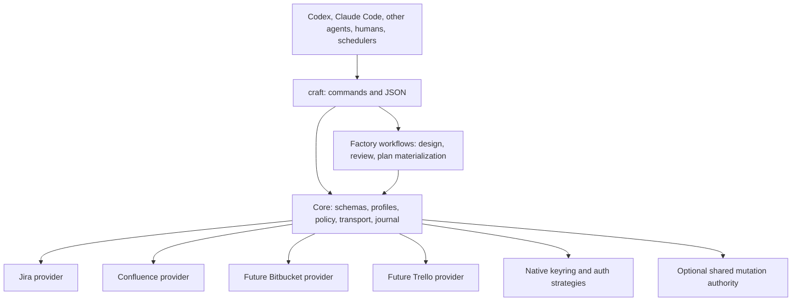

# Provider architecture for the factory cloud CLI

Status: proposed design, 9 November 2026. Build **Craft**, one agent-facing CLI with a shared core, provider modules, and separate factory workflows. Start with Jira and Confluence. Add Bitbucket, Trello, and other services through the same extension contract. The selected executable name is `craft`; no binary or plugin system exists yet.

The [command catalog](cloud-cli-command-catalog.md) owns resource commands and API mappings. The [existing implementation plan](atlassian-agent-cli-plan.md) owns platform auth/storage and delivery milestones. The [contract](atlassian-agent-cli-contract.md) owns envelopes and plan review. These documents extend that plan without renaming its existing file paths.

## Layers and ownership



The shared core owns input/output, local configuration, safe HTTP primitives, credential locks, pagination budgets, rate-limit handling, binary I/O, operation identity, recovery records, audit fields, and policy evaluation. A provider owns native resources, payload schemas, API versions, route construction, auth strategy selection, scope requirements, semantic errors, and operation-specific reconciliation.

Factory workflows compose provider operations. `plan tickets-create` imports and verifies a reviewed page, builds a frozen mutation manifest, creates issues, then records mappings. General `jira issue create` is a distinct resource operation with its own authorization. Workflow review requirements must not be encoded as a universal ban inside the Jira adapter.

Suggested module changes to the initial layout:

```text
crates/craft/src/
crates/craft-core/src/{contracts,profiles,auth,secrets,transport,policy,journal}/
crates/craft-providers/src/{jira,confluence}/
crates/craft-workflows/src/{design,plan}/
schemas/{core,providers,workflows}/
tests/{contract,provider-conformance,security,platform,sandbox}/
```

These are proposed boundaries, not a requirement to create all crates immediately. Begin with modules if that keeps the first release smaller. Avoid provider dependencies in the core. A thin future MCP server should invoke the same contracts and policy paths.

## Shared contract, native meaning

Use the same envelope and lifecycle for every command, but retain resource-specific actions. Jira transition IDs, Confluence content badges, Trello list moves, and Bitbucket PR approvals are not a universal `status` field. Cross-provider mappings are explicit configuration with a source revision, not inferred from matching names.

Introduce durable resource references with `provider`, `deployment`, `tenant`, `resource_type`, `id`, and optional human URL. IDs remain opaque strings. Jira issue keys and Confluence space keys can be display aliases; retain immutable IDs where available. A shared task can link to a page, issue, card, PR, commit, pipeline run, and artifact without forcing all of them into one object schema.

Every result reports source provider, target, effective actor, and relevant version/etag/digest when available. Preserve provider data in an explicit native section with declared schema/size bounds. Do not drop fields and present a lossy projection as a complete export.

Output selection, summaries, and `--max-bytes` reduce agent context use. Truncation is explicit. Retrieved pages, comments, attachments, and repository files are untrusted data: their text cannot change auth hosts, policy, approval authority, or executable/plugin discovery.

## Provider and operation descriptors

Maintain a versioned, machine-readable descriptor as the source for command schemas, capability discovery, and reference generation. A descriptor contains:

| Area | Required information |
| --- | --- |
| Provider identity | Stable ID/version, deployment types, trusted host templates, documentation/spec revision and digest |
| Authentication | Supported strategy IDs, issuer/audience, token routing, grant ownership, refresh/revocation behavior, discovery method |
| Operation identity | Stable command/operation ID, input/output schema references, method/route template, native resource identity |
| Authorization | Scope alternatives expressed as OR-of-AND sets, provider permissions, local capability bundle, tenant conditions |
| Request semantics | Body format, content type, multipart/binary support, maximum sizes and preconditions |
| Results | Pagination strategy, async-job adapter, effect classification, version/conflict semantics |
| Recovery | Retry class, provider idempotency support if documented, correlation fields, reconciliation method and unknown-outcome handling |
| Evidence | Documentation reviewed, fixture coverage, live sandbox verification and supported auth modes |

Static descriptors describe what is implemented; runtime capability results describe what is available for a selected profile and target. Distinguish `implemented`, `policy_enabled`, `credential_scoped`, `tenant_supported`, and `verified`. Any can be `unknown` where the provider cannot establish it safely. A scope does not prove effective permission. Never run destructive probes to discover capability.

Initial discovery commands should include `provider list`, `provider describe`, `schema --command ...`, and `capabilities --profile ... --target ...`. Schema and descriptor versions are independent of the CLI release version. Changes to flags, envelopes, or semantic effects require compatibility review.

The [agent interface requirements](agent-cli-efficiency-and-skills.md) add bounded `command find`, compact/property/full schema views, local `input validate`, curated projections and progressive companion skills. Generate discovery, validation and any MCP schema from the same operation model. Enforce strict parse/semantic checks in code; a skill cannot be the only defense against agent input errors. Cache versioned schemas without treating cached metadata as current authorization.

The [list/projection contract](list-paging-and-response-schema.md) defines response-schema views, server/local field selection, cursor-bound queries, remainder buffering, cache provenance and explicit scan limits. Each adapter declares its native continuation and projection mechanisms. Do not omit required upstream next/version/identity fields when projecting data or advertise snapshot consistency without provider evidence.

Generate route clients from pinned OpenAPI when useful, but keep permission checks, safe retries, output shaping, and workflow semantics in reviewed code. A generated method existing does not mean it is a supported CLI command. Schema refreshes must report changed/deprecated routes and scope requirements before shipping.

## Authentication across providers

Keep native OS keyring storage for all credentials. Partition credential keys by provider, issuer/app, grant, and effective identity; profiles refer to credentials without copying them. Shared core utilities can implement locks, secure provisioning, broker transactions, and rotation storage. Provider strategy metadata controls the actual protocol. Do not assume one Atlassian token, scope vocabulary, discovery call, or cloud-ID gateway works across every product.

The Jira/Confluence service and delegated-broker modes remain the initial researched paths. Bitbucket uses its own API base and OAuth token endpoint, `https://bitbucket.org/site/oauth2/access_token`; token types have different permissions and identity behavior. OAuth is the preferred initial extension path. Adding static access-token strategies would be a separate product decision and capability, not an implicit fallback. [A44]

Trello now documents OAuth2 with PKCE. Its confidential flow still requires a client secret. Its configuration guide also documents secretless public clients, chiefly for front-end Power-Ups; that does not establish a tested desktop CLI callback/distribution flow. The provider spike must resolve registration, allowed redirects, endpoint compatibility, and consent before selecting direct native login or the broker. [A46, A48]

The Trello confidential guide lists and implements `/oauth/token` but says `/authorize/oauth/token` in prose. Treat the latter as an unresolved documentation inconsistency. Verify the intended endpoint using the provider's current guidance and a sandbox exchange. Never send credentials to alternative endpoints automatically after an auth failure. [A46]

## Writes, jobs, and distributed execution

Core operation IDs bind provider, tenant, actor/grant, target, command, input digest, and workflow approval where applicable. The journal retains confirmed remote IDs and step outcomes. A local journal is an execution record, not a shared ledger or cross-machine lock. A coordinator can use the same descriptor and operation protocol to own leases, deduplication, and rate budgets.

Providers implement operation-specific recovery. Read retry, upload retry, transition retry, and asynchronous delete polling cannot share an unconditional retry rule. An HTTP 202 creates a remote-job handle; the core tracks accepted/running/succeeded/failed/unknown states without confusing local submission with remote completion. Cross-provider workflows report partial effects and never claim a distributed transaction.

For cloud workers, give each machine a separately provisioned credential or a validated single refresh owner. The task requester, effective API actor, agent run, and human approver are separate audit fields. Ownership belongs to the team and workflow policy; it need not bind each agent to one human account. Local CLI policy cannot enforce separation of duties against an actor who can bypass the CLI, so consequential controls require provider enforcement or a restricted mutation service.

## Extension mechanism and delivery order

Ship compiled first-party providers first. This keeps route/auth review, packaging, compatibility, and secret handling in one release process. Do not build a marketplace or dynamic runtime before proving the first two providers.

If independent extensions become necessary, add an explicitly installed, versioned out-of-process plugin protocol. Installation must identify publisher/package digest and trust policy. Never execute a plugin discovered automatically from a repository, page, or attachment. Plugins declare commands, schemas, hosts, permissions, and protocol versions; the host validates them before execution.

Prefer host-mediated operation requests that receive a credential reference rather than raw tokens. The host constructs or validates the allowed route, applies policy, authenticates, and bounds the response. A local subprocess is not a sandbox: only trusted plugins can run unless a real isolation mechanism is deployed. Arbitrary credential-bearing HTTP or unrestricted provider requests would undo the command policy and are excluded by default.

Delivery sequence:

1. Establish shared contract, keyring/auth, journal, descriptors, Jira/Confluence core CRUD and binary operations.
2. Add review-page planning, approved-plan materialization, privileged bundles, and verified shared mutation authority.
3. Implement one future provider end to end, preferably Bitbucket PR read/comment/review integration, to test that a provider can be added without rewriting the core.
4. Add Trello after its OAuth/callback and endpoint-compatibility spike. Define board/list mappings explicitly.
5. Extract narrow workflow ports such as `WorkLedger`, `DocumentStore`, and `CodeReviewHost` only after two implementations demonstrate their common contract. Keep unsupported features visible.

Provider acceptance requires schema-valid CLI results, target isolation, pagination, revoked/missing scopes, permission errors, 429 handling, malicious redirects, secret redaction, version conflict where supported, async completion, partial and unknown outcomes, and native resource semantics. Live sandbox evidence is recorded per provider/auth mode. None of those runtime checks has been performed by this documentation research.
