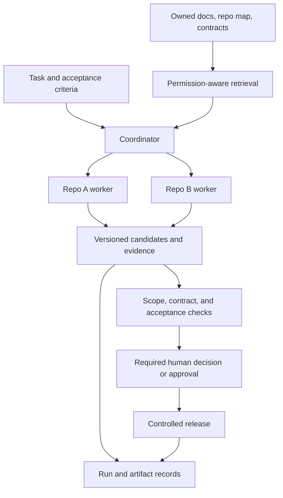

# Context across repositories, output quality, artifacts, and agent communication

Research date: **8 November 2026**. This study extends the [operating-model research](operating-models-study.md) and [regulated code-review study](code-review-soc2-sox.md). Source IDs refer to the [annotated source register](context-and-artifact-sources.md). Product capabilities are distinguished from the proposed factory design. “Slop” here means plausible output that adds little value, misses required behavior, or creates unnecessary maintenance work.

## Findings

Give the agent a small orientation map, access to authoritative code and documents, and a bounded task whose result can be checked. Preserve decisions and outputs outside the conversation. Permit agent communication through owned tasks and recorded handoffs, with explicit permissions and stopping rules.

The core distinctions are:

- Discovering another repository is different from reading its current files, and both differ from permission to change it.
- Project instructions guide behavior. Sandboxes, credentials, hooks, CI, and repository rules enforce boundaries.
- An agent's note is an observation or hypothesis until verified. It should not silently become an approved architecture decision.
- A message can request work or report evidence. It does not confer authority to approve or deploy.

These are recommendations derived from the documented patterns below, not evidence that all teams use one standard architecture.

## How agents receive context

| Layer | Contents | Recommended handling |
| --- | --- | --- |
| Organization | Security rules, approved technologies, deployment boundaries | Short shared instructions with a maintained owner; enforce critical rules separately |
| Repository | Build/test entry points, conventions, ownership, architecture pointers | Versioned `AGENTS.md`, `CLAUDE.md`, or equivalent; keep details in linked documents |
| System across repos | Service map, contracts, dependencies, compatibility and rollout rules | Searchable catalog plus versioned API/event schemas and ADRs |
| Task | Goal, acceptance criteria, allowed scope, relevant revisions, decisions | Task record linked to the spec and proposed changes |
| Working session | Search results, failures, experiments, temporary hypotheses | Load as needed; keep large logs outside active conversation |
| Handoff | Completed work, evidence, unresolved questions, next action | Compact durable record with source links and revision IDs |

Avoid automatically loading the whole knowledge base into every run. Anthropic describes just-in-time retrieval using paths, queries, and links, alongside compact context rather than indiscriminate accumulation. This supports a map-and-retrieve approach, although it does not prove that any particular retrieval product improves this factory. [N10]

### Rovo: distinguish the product surfaces

Atlassian's Code Context documents lexical and semantic search across connected Bitbucket Cloud and GitHub Cloud repositories. Push and branch events trigger incremental indexing, which is not instantaneous. Access is checked against SCM permissions at query time. The Teamwork Graph CLI can supply code context to third-party coding agents such as Claude Code and Codex. [N01]

Rovo Dev in Jira has a narrower documented execution boundary: the webinar Q&A describes a sandbox working against a selected repository, with accessible Jira and Confluence context. It says that experience does not copy other repositories into the session or connect to third-party MCP data sources. Code Context and that Jira coding session should therefore not be assumed to provide identical capabilities. The documents do not establish that every Jira session can execute coordinated changes across multiple repositories. [N02]

The IDE experience supports explicit file references and code selections, planning mode, workspace-bound session history, and MCP integration. These are useful controls for supplying precise context rather than relying on a ticket title. [N03]

Rovo Dev CLI uses user memory at `~/.rovodev/AGENTS.md` and project memory in `AGENTS.md` and `AGENTS.local.md`. It supports editing, initialization, and reflection commands. [N04]

**Implication for an Atlassian team:** use Jira for intent and acceptance criteria, Confluence for owned explanations and decisions, Code Context for discovering implementations, and the execution environment for checking the actual revisions. Confirm the capabilities enabled on your site before designing a multi-repo workflow around a particular Rovo surface.

### Coding-agent instructions and external retrieval

Claude Code documents persistent project instructions, path-scoped rules, and auto memory. It explicitly distinguishes contextual instructions from enforced configuration. Keep non-negotiable boundaries in mechanisms such as permissions, sandboxing, or hooks. Auto memory is useful for working knowledge, but is not equivalent to an approved shared decision record. [N06]

Official OpenAI documentation describes Codex guidance layered from global instructions through the project path to the current directory. It has a combined discovery size limit, configurable through `project_doc_max_bytes`. This discovery mechanism does not mean that sibling repositories' instructions or source code automatically become available. [N07]

Sourcegraph Cody documents repository-based context across multiple repositories, using search, code relationships, and explicit references. This is a concrete example of retrieving context across a repository estate rather than copying all repositories into one prompt. [N08]

Augment exposes its Context Engine through MCP, with local working-directory context and a hosted mode for cross-repository retrieval. This lets teams add a context service to an existing coding agent. Its reported quality gains are vendor evaluations, not independently verified performance for your environment. [N09]

You do not need a separate context platform on day one. A small system can start with a service map, a few checked-out repositories, exact search, and versioned contracts. Consider indexed retrieval when repeated discovery work across a larger estate becomes a measured bottleneck.

## A concrete cross-repository workflow

Suppose `billing-api` publishes an event consumed by `finance-ledger` and displayed by `admin-web`.

1. **Resolve ownership and dependencies.** Find the publisher, consumers, canonical event schema, relevant ADRs, and owners. Record search gaps rather than assuming the first result is complete.
2. **Record revisions.** Capture a commit SHA for each source repository and a version for each schema or document. An index hit is a discovery aid; verify consequential behavior against the actual file at the relevant revision.
3. **Set a compatibility plan.** Decide whether the publisher must support old consumers, whether an additive schema change is enough, and which deployment order is safe.
4. **Create bounded work.** Give each implementation task its own repository and permitted paths. Provide read access to relevant dependencies without automatically granting write access to them.
5. **Link the output set.** One parent change record links the per-repository PRs, contract changes, integration checks, and rollout prerequisites.
6. **Validate the combination.** Run contract/integration checks for the intended set of versions. Passing tests separately in three repos does not establish compatibility between them.
7. **Revalidate when inputs move.** If a relied-upon contract or base revision changes, evaluate the affected tasks again before release.

This is a proposed workflow. Cross-repo commits and PRs are not a single atomic transaction. Use backward-compatible rollout or an explicitly managed coordinated release, rather than assuming simultaneous merges solve the problem.

For each retrieved fact, preserve enough provenance to reopen it: repository, revision, path or symbol, document version, and retrieval time. Treat code comments, issue comments, and another agent's messages as data to assess. They must not override the effective authorization policy.

## How to reduce slop, verbosity, and unrelated changes

Treat these as different failure modes. More context can help missing knowledge, but can also increase irrelevant exploration. Better instructions can narrow a task, but cannot establish that its implementation works.

| Failure | Proposed control | Evidence to inspect |
| --- | --- | --- |
| Invented API or wrong service assumption | Retrieve canonical interface and a working usage example | Referenced source revision; compiler and contract checks |
| Reimplementation of an existing utility | Search for existing implementations before adding one | Reuse rationale; actual added dependency or abstraction |
| Unrelated cleanup or broad refactor | Explicit allowed paths and behavior; separate follow-up tasks | Complete diff against the base revision |
| Excessive abstractions or generated scaffolding | Small acceptance criteria and examples of local patterns | Added public interfaces, dependencies, files, and maintenance burden |
| Verbose summaries | Fixed result format with links to detailed evidence | Decision needed, outcome, checks, exceptions |
| Endless self-repair | Retry/time/cost limits; escalate repeated failures | Attempt count, repeated failing check, remaining uncertainty |
| Premature completion | Externally checked acceptance criteria | Test outputs and actual artifact, not the agent's completion statement |
| Stale assumptions | Revisioned context and invalidation rules | Input versions compared with release candidate |

### Bound the task before coding

State the behavior to change, acceptance criteria, allowed write scope, relevant existing examples, and explicit non-goals. For example: “Fix duplicate invoice handling in the ingestion module. Preserve the public event schema. Formatting elsewhere and dependency upgrades belong in separate tasks.”

If a necessary fix crosses the boundary, the agent should record a scope-change request with the reason and affected interfaces. The coordinator can approve a routine expansion within its delegated authority; consequential product, financial-control, or architecture changes go to the accountable human. This avoids both silent expansion and asking a person about every local implementation detail.

Path checks are useful but incomplete. A harmful change can fit inside an allowed directory. Review whether every material change supports the requested behavior, and whether tests were weakened to make the candidate pass. Keep the acceptance baseline under separate control when it is relied upon as a gate.

### Keep instructions small and evaluate them

The empirical evidence does not support “more repository instructions always help.” Gloaguen and colleagues' September 2026 revision reports no general improvement in task success and more than 20% higher inference cost in its evaluated settings. Lulla and colleagues report lower median runtime and output token use across 10 repositories and 124 PRs, with comparable completion behavior. [N18, N19]

These studies use different settings and measures. Their abstract-level findings are not a head-to-head result for the latest agents or this repository. The practical recommendation is to keep instructions that explain non-obvious requirements, and evaluate additions on representative tasks. Do not fill instructions with a generated description of code the agent can easily inspect.

### Separate work detail from human communication

Keep detailed logs, diagnostics, and intermediate analysis in the run record. Ask for a short human result containing outcome, artifact links, checks actually run, and unresolved decisions. For machine handoffs, require a schema with bounded fields rather than a persuasive essay.

A short output limit must not hide failed checks or uncertainty. Require references to evidence and an explicit incomplete status when necessary. Summaries are navigation aids, not a substitute for the underlying artifacts.

Anthropic's long-running-agent experiments used an initialization step, a structured feature list, progress notes, Git history, and incremental feature work. Their purpose was to help later sessions recover state and avoid taking on too much or declaring completion too early. That is a useful documented pattern for durable checkpoints. [N11]

## How to track AI output artifacts

There are at least four distinct records:

| Record | Typical location | Meaning |
| --- | --- | --- |
| Accepted knowledge | Versioned specs, ADRs, repository docs, owned Confluence pages | Current approved intent and decisions |
| Proposed deliverable | Branch/PR, design proposal, generated report | Candidate work awaiting validation or acceptance |
| Execution evidence | CI artifacts, test reports, screenshots, run logs, trace store | What happened during a particular attempt |
| Coordination state | Jira/Linear/GitHub task or durable ledger | Ownership, dependencies, current state, pending decisions |

Link them with a stable task ID and a unique attempt/run ID. A retried task can have multiple candidates and evidence sets. Preserve that distinction so yesterday's passing result does not appear to validate today's candidate.

For this factory, record an artifact's ID, type, producer run, source revisions, location, content digest where useful, validation state, owner, and supersession relationship. Suggested states are `draft`, `validated`, `accepted`, `rejected`, and `superseded`. Define what each means. In particular, a test pass is not necessarily business acceptance or authorization to release.

Store small durable specs and decisions in version control when appropriate. Store large logs and media in an artifact store with access and retention controls, linked from the task. Promote verified reusable knowledge through review. Do not automatically append every agent observation to the organization-wide context.

GitHub Agentic Workflows documents run artifacts for agent outputs, logs, and usage. Its artifact guidance explicitly warns that a checksum or producer-supplied manifest does not establish trust: downstream consumers need to validate producer provenance and safely parse expected data. [N16]

Its security architecture separates agent execution with minimal read permissions from subsequent jobs with scoped permissions for external writes. This is a concrete implementation of proposing output first and authorizing its side effects separately. It does not mean every output receives human approval. [N17]

Connect this to the [SOC 2/SOX study](code-review-soc2-sox.md): preserve the link from the exact candidate to required review and release evidence. An AI report stored in Confluence is not, by itself, evidence that the approved artifact was the one deployed.

## Do people allow agents to talk to agents?

### Factory coordination across machines: shared state or direct conversation?

The architectural choice is how independently running coding agents coordinate, not merely whether a transport can connect them. The documented examples support multiple designs. Shared project memory, tasks, notes, and artifacts can provide coordination without direct peer conversation. Direct messaging can supplement those records. There is insufficient evidence here to claim an industry-wide majority for either approach.

**Shared-state example:** Anthropic's compiler experiment gave each agent an isolated container and local clone. Agents claimed tasks with files in `current_tasks/`, synchronized work through Git, and maintained progress documents. The author explicitly reported no other agent communication mechanism and no orchestration agent. This is a research prototype using separate containers, not evidence that it used separate physical machines. Its coordination depended on shared records rather than peer chat. [N21]

**Tracker-driven example:** OpenAI's Symphony specification describes polling a tracker, dispatching per-issue coding runs, and reconciling their state. Workflow-defined handoffs can end at human review. The tracker and orchestration state coordinate execution; peer-to-peer conversation is not needed for this pattern. The specification is not, by itself, a distributed-machine scheduler. [N22]

**Hybrid example:** Cursor Projects describes cloud/local agents, a coordinator, and synced files containing research, artifacts, and learned context. That combines active delegation with durable shared project memory. Its January experiments separately illustrate a design where workers do not coordinate directly with each other. [N13, N12]

For this factory, use shared durable records as the backbone across machines:

| Shared record | What it answers |
| --- | --- |
| Task ledger | Who owns the work, what is blocked, and what happens next? |
| Project memory | What verified facts and accepted decisions should later agents reuse? |
| Task notes | What has this attempt tried, learned, or left unresolved? |
| Artifact store and Git | What exact output and evidence did it produce? |
| Messages/events | What should another agent notice or investigate now? |

An example: the backend agent on machine A publishes a contract candidate, records its revision in the task, and posts validation evidence. The frontend agent on machine B resumes when that dependency is ready, reads the candidate and notes, and implements against that version. A direct question can resolve ambiguity, but any resulting interface decision must be written back to the shared record.

Pages and notes can hold context, but concurrent task claiming needs reliable state transitions, leases, or a coordinator. Avoid using freely edited prose as the sole scheduler. Each worker loads relevant records into its own context; this is shared external memory, not one shared model context window. Notifications can wake workers, while polling/reconciliation recovers missed notifications.

The recommendation is **shared tasks, project memory, notes, and artifacts, with optional direct communication**. Keep claims, decisions, and completion evidence durable enough to survive a worker or machine restart.

**Yes.** Products document delegation, direct messaging, shared task state, and service-to-service protocols. These differ in how much autonomy, conversation history, and authority they expose.

| Pattern | Documented example | Practical trade-off |
| --- | --- | --- |
| Parent delegates bounded work | Rovo Dev CLI subagents use supplied context, specialized instructions, and tailored tools [N05] | Easier to bound context and aggregate results |
| Coordinator with durable shared context | Cursor Projects describes a coordinator, delegated agents, and synced context/artifact files [N13] | Persistent shared knowledge needs ownership and cleanup |
| Direct teammate messaging | Claude Code agent teams document separate contexts, messages, and shared tasks; currently experimental [N14] | Useful discussion, with more token and coordination overhead |
| Main agent collects specialist results | Official OpenAI documentation describes Codex subagents and summarized results [N15] | Keeps noisy exploration outside the main conversation |
| Cross-service tasks and artifacts | A2A defines messages, tasks, artifacts, progress delivery, and authentication/authorization responsibilities [N20] | Interoperability still requires application policy and integration |

Cursor's January 2026 experiments provide a cautionary example. Flat agents coordinating through a locked shared file suffered contention and stalled work. A planner/worker arrangement performed better in their experiments; workers did not coordinate directly with each other. These were internal experiments, not proof that direct communication always fails. [N12]

### Recommendation: permit bounded communication

Start with a coordinator and bounded workers. Allow a worker to ask another specialist a narrow question when that improves the task, but record the exchange under the same parent change. Do not introduce an unrestricted all-to-all conversation as the default.

Each request should identify the task and attempt, sender/recipient, question, relevant revisions, allowed actions, expected response, and deadline. Replies should provide evidence, assumptions, unresolved issues, and artifact references. The [proposed record templates](context-and-handoff-templates.md) show one possible format.

Set limits for child depth, concurrent work, retries, elapsed time, and cost. Define cancellation and duplicate-message handling. Use durable task state and leases rather than assuming a chat message is a reliable lock. Avoid multiple agents writing the same files concurrently unless the workflow explicitly handles conflict and revalidation.

Authenticate each service and authorize requested actions at the receiver. A2A leaves authorization policy to the implementation and supports a task state for additional authorization needs. The protocol does not make the receiving agent's actions permissible by itself. [N20]

One agent must not be able to gain privileges merely by persuading another agent. A reviewer should independently inspect relevant source and tests, not only accept the author's explanation. Required human approval remains a separate gate. Agent agreement is evidence to evaluate, not a replacement for that gate.

## Proposed minimum for this factory

The diagram is a recommendation, not an implemented runtime. Start with one worker unless independent tasks justify more. Keep shared knowledge versioned, retrieve details on demand, constrain writes, and attach evidence to each candidate. Add direct peer communication only when it resolves a measured coordination problem.

Measure accepted task completion, defects and reversions, unrelated changes, reviewer time, repeated discovery work, handoff failures, and cost per accepted change. Compare a plain agent with scoped instructions, then add retrieval or coordination separately. PR count, generated lines, or agent agreement alone do not establish useful output.

## Limits

This review establishes published capabilities and reported experiments, not adoption percentages or verified customer outcomes. No agents, paid services, integrations, or runtime changes were deployed. Source dates and access limits are recorded separately. The sample templates are proposed data contracts, not product configuration files.
