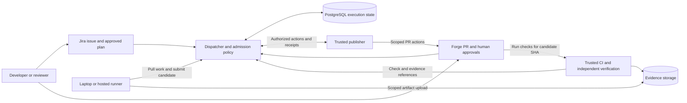

# Software factory architecture and technology stack

**Proposed decision for Craft · 20 November 2026**

Use a small Rust launcher, local SQLite, and existing CI for the supervised pilot. Keep Craft as the provider CLI. When multiple unattended runners need the same queue or reliable takeover, add a modular Rust service backed by PostgreSQL. Use existing CI or ephemeral VMs to run jobs, and put automated forge writes behind a separately authorized publisher.

This decision follows the [factory MVP and end state](factory-mvp-and-end-state.md) and its [requirements](factory-requirements-and-pilot.md). It assumes one team, a representative repo, an existing protected CI path, and explicit human delegation for the pilot. The [factory delivery plan](../plans/factory-delivery-plan.md) defines the detailed tasks and acceptance gates.

## Discussion and vote

Three agents independently proposed designs for workflow and storage, runners and tooling, and trust and operations. After sharing the proposals, all three ranked the same four pilot options and selected a mature default. The facilitator synthesized the decision and did not cast a ballot.

| Agent perspective | MVP ranking | Mature vote | Decisive reason |
| --- | --- | --- | --- |
| Workflow and storage | A › B › C › D | E | Local state is enough to validate the human repair loop. Shared claims and publication reservations eventually need one transactional authority. |
| Runners and tooling | A › B › C › D | E | A portable work order and candidate handoff let the pilot exercise both interactive and headless agents. Existing CI can execute jobs in either architecture. |
| Trust and operations | A › B › C › D | E | Human publication and protected CI give the pilot a small trust boundary. The shared design needs an independent publisher and durable action records. |

**MVP vote** was 3–0 for A. **Mature vote** was 3–0 for E among E, F, and G. These are design judgments from this review. The earlier 2–1 decision about which workflow to pilot remains in the MVP brief.

| Option | When it earns its place |
| --- | --- |
| **A. Supervised local launcher and existing CI** | First choice for a human-delegated Jira-to-PR pilot, manual alternate-tool handoff, and a real request-changes cycle. |
| **B. CI-native scripts and forge state** | First choice if the pilot narrows to recurring failed builds in one repo with a hardened CI path. Also the recommended second workflow. |
| **C. Shared Rust and PostgreSQL service from day one** | Move this forward if the pilot requires competing unattended runners or reliable takeover while a laptop is offline. |
| **D. Workflow engine from day one** | Worth evaluating if the team already runs one and the first workflow requires durable waits and multi-step recovery. |
| **E. Shared Rust and PostgreSQL service with isolated workers** | Default when the principal shared needs are admission, claims, review capacity, status, and publication reconciliation. |
| **F. Temporal-led orchestration with durable domain and publisher state** | Reconsider when several real workflows repeatedly need multi-day timers, signals, cross-repo fan-out and joins, compensation, and safe workflow upgrades. External side effects still need reconciliation and idempotency controls. [Temporal activities](https://docs.temporal.io/activities) · [Temporal SDKs](https://docs.temporal.io/develop) |
| **G. CI and forge as the sole execution authority** | Suitable for a single-forge deployment if its controls demonstrably cover shared claims, recovery, and publication reconciliation. CI remains useful as an execution backend in E or F. |

OpenAI Symphony is a reference for tracker polling, workspace lifecycle, and dispatch. Evaluate an existing scheduler against the same acceptance cases before adopting it. Its documented recovery approach supplies a useful design comparison for the execution and publication records proposed here. [Symphony specification](https://github.com/openai/symphony/blob/main/SPEC.md)

## Components and stack

| Component | Pilot stack | Shared and mature stack |
| --- | --- | --- |
| **User workflow** | Jira issue for ownership and intent, optional versioned Confluence plan, and one GitHub or Bitbucket draft PR with a short evidence brief. A person delegates, publishes, and decides in the existing tools. | Add standing pickup rules and authorized CI or review triggers. Preserve native review and approval. Add a small cross-tool status view if people routinely need one. |
| **Launcher and dispatcher** | A separate Rust executable using `clap`, Serde, JSON Schema, Tokio for child-process supervision, the Git CLI, and local `rusqlite` for attempt state. Use Craft's published command contracts for Jira and Confluence where qualified. | One modular API and dispatcher using Rust, Axum, Tokio, and SQLx on the team's existing container platform. PostgreSQL owns transactional attempts, claims, review slots, budgets, and action records. Workers connect outbound to the authenticated HTTPS API. An optional AI coordinator proposes plans or resolves ambiguous handoffs through the same admission policy. |
| **Agent runners** | Start with headless `codex exec --json` and a versioned result schema. Accept a manually submitted commit and short handoff from any approved interactive tool, including Codex Desktop, Claude Code, Cursor, and Rovo Dev. | Qualify adapters one at a time. Prefer the developer's permitted runner when it meets repo, data, and capability policy. Hosted jobs use isolated, disposable execution. Laptop runners use repo allowlists and per-attempt checkouts under an appropriate sandbox. |
| **Shared context and skills** | Use pinned Git, Jira, and Confluence revisions in a work order. Load one reviewed team skill from its pinned source. | Resolve authorized context from existing sources. Use a versioned Git skill catalog and each tool's supported loader. Offer bounded Craft CLI or approved MCP tools for on-demand retrieval. [MCP architecture](https://modelcontextprotocol.io/docs/learn/architecture) |
| **Verification** | A fresh verifier and forge CI check the exact candidate SHA. Take required test policy from a trusted revision or enforce owner review for modifications. | Use provider-specific check and reviewer identity, provenance where applicable, and risk-based policy enforced by the trusted service and forge. |
| **Publication and identity** | A human opens or updates the PR and uses the forge's native controls. The automated worker's account and environment are scoped to its assignment. | A separate publisher uses narrowly authorized provider credentials from the team's managed secrets store. Use the existing identity provider for team access and short-lived workload credentials where supported. Keep candidate code outside the publisher. |
| **Artifacts and telemetry** | Store small structured receipts locally. Link CI results and artifacts through existing storage. | Keep indexed metadata in PostgreSQL and larger evidence in approved object storage. Export typed Rust `tracing` signals via OpenTelemetry to the team's current backend. Keep durable decision and action records separate from sampled telemetry. |
| **Operations and maintenance** | Select one failed CI run as the second workflow. Use its exact job, attempt, and source revision. | Connect source and approved change intent to deployed artifact, service ownership, and runtime inventory. Provide scoped read-only diagnostics. Use Renovate and scanners for discovery, and route bounded upgrade or test work through the same factory. |

The inspected Craft workspace already uses `clap`, Serde, JSON Schema, Tokio, and `rusqlite`. Put factory lifecycle and scheduling outside `craft-core`. Reference Craft's provider receipts where relevant and keep the factory's attempt state in its own store. This lets the factory and CLI evolve independently through versioned contracts. [Cargo workspace](../../cli/Cargo.toml) · [Craft delivery and recovery](../../cli/docs/delivery-path.md) · [Axum](https://docs.rs/axum/latest/axum/) · [SQLx](https://docs.rs/sqlx/latest/sqlx/) · [OpenTelemetry Collector](https://opentelemetry.io/docs/collector/)

## Shared execution and trust boundaries

For the pilot, a local launcher and SQLite cover execution state. Replace the publisher step with a person acting through the forge. The hosted design adds the shared dispatcher and its trust boundary when unattended work needs them.

- **Portable contracts.** A versioned work order carries the human owner, repo and base SHA, intended outcome, acceptance checks, data and write limits, and context and skill revisions. A run receipt records what the launcher observed, including outcome, candidate SHA, artifact digests, and usage where available. Model-produced summaries and structured results are claims for verification. A different agent can resume from the work order, candidate and evidence. Interactive steering and resumable native sessions are optional adapter capabilities. [Codex headless mode](https://learn.chatgpt.com/docs/non-interactive-mode) · [Codex App Server](https://learn.chatgpt.com/docs/app-server) · [Claude Code automation](https://code.claude.com/docs/en/headless) · [Cursor CLI output](https://cursor.com/docs/cli/reference/output-format) · [Rovo Dev CLI](https://support.atlassian.com/rovo/docs/rovo-dev-cli-commands/)
- **One shared execution authority.** Keep SQLite on the pilot host. In PostgreSQL, claim work and reserve capacity in one transaction. Use database time for lease expiry and a monotonically increasing generation to reject stale runner updates. Use unique constraints for external event IDs and logical actions. Row selection with `FOR UPDATE SKIP LOCKED` helps available workers claim queue rows. Admission and review limits still need their own transactional enforcement. [SQLite WAL constraints](https://www.sqlite.org/wal.html) · [PostgreSQL locking](https://www.postgresql.org/docs/current/sql-select.html#SQL-FOR-UPDATE-SHARE)
- **Recoverable external writes.** Reserve a logical action against the current attempt, candidate SHA, and policy before calling the forge. Release the database transaction before the remote call. If the response is lost, reconcile against provider state before repeating the operation or accepting a conflicting one. Escalate when the result cannot be proved. Use a native idempotency key or expected revision where the provider supports it.
- **Forge capability is part of the policy.** GitHub documents scoped, expiring App installation tokens and an expected head SHA for REST merge. Bitbucket's repository PR write token includes approval and merge, and its documented merge request lacks an expected-head field. A read immediately before merge leaves a race. Qualify draft publication and automated merge separately. Verify that the publisher cannot bypass protected branches or satisfy an independent human approval. Require enforceable revision binding for automated merge. Keep the corresponding action human-controlled where the forge cannot provide the required controls. [GitHub App tokens](https://docs.github.com/en/apps/creating-github-apps/authenticating-with-a-github-app/generating-an-installation-access-token-for-a-github-app) · [GitHub merge API](https://docs.github.com/en/rest/pulls/pulls#merge-a-pull-request) · [Bitbucket token permissions](https://support.atlassian.com/bitbucket-cloud/docs/repository-access-token-permissions/) · [Bitbucket merge API](https://developer.atlassian.com/cloud/bitbucket/rest/api-group-pullrequests/#api-repositories-workspace-repo-slug-pullrequests-pull-request-id-merge-post) · [Bitbucket merge checks](https://support.atlassian.com/bitbucket-cloud/docs/suggest-or-require-checks-before-a-merge/)
- **Execution and data isolation.** A worktree isolates files. Use a sandbox, isolated CI job, or disposable VM with scoped credentials and network access to enforce policy when running candidate code. Authorize both the context source and the model destination. Keep secrets and raw prompts out of routine receipts. Production investigation uses a scoped read interface with service, environment, time window, and redaction enforced by the data service.

## Build order and evidence

| Order | Deliverable | Evidence before advancing |
| --- | --- | --- |
| **1. Prove the local loop** | Versioned work order and receipt, local launcher, Codex adapter, manual handoff, and existing CI. | Complete a real request-changes cycle. Recover a stopped launcher without confusing candidates. A second approved tool uses the same pinned skill and hands off to the same verification path. |
| **2. Add CI-triggered work** | Use a human-selected failed run first, then one authorized trigger when evidence is adequate. | Pin the failing job and commit, deduplicate repeat deliveries, and produce a verified candidate or an actionable escalation. A weakened check or stale approval leaves the candidate blocked under policy. |
| **3. Share execution** | Add the PostgreSQL service, publisher, and a second unattended worker when the queue requires them. | Two workers race for one order. The losing or expired worker cannot publish. A dropped response after a remote write is reconciled before another conflicting action. A full review queue reduces admission. |
| **4. Expand by measured need** | Qualify another agent adapter and a cross-repo workflow. Add governed operational reads and evaluate narrow auto-merge in shadow mode. | Compare reviewer minutes, cost per accepted change, queue age, and recovery time. Verify downstream dependencies and deployed versions. Revisit a workflow engine when durable coordination becomes a recurring maintenance burden. |

The technology choices are proposals. Runner parity, forge enforcement, shared recovery, and operating cost need evidence from the team's real pilot.
