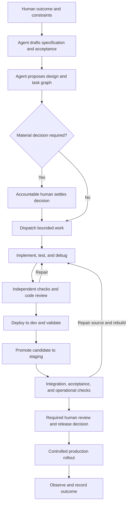

# Human-governed, agent-executed delivery and operations

Proposed operating model, **8 November 2026**. This makes the [reference architecture](reference-architecture.md) concrete for a team whose humans define workflows, skills, MCP integrations, CLI tools, and review policy while agents perform delivery and operational work. It is a blueprint, not a configured or deployed system. “CLI” is the assumed meaning of “clu” in the request.

## Responsibility split

Humans own business intent, acceptable risk, system ownership, authorization, and acceptance. Agents can draft plans, work breakdowns, high-level designs, detailed designs, implementations, tests, and operational diagnoses. The workflow determines when a person must decide, rather than requiring approval of every intermediate artifact.

Humans cannot entirely withdraw into maintaining agent tooling. Someone still needs to resolve conflicting requirements, accept consequential trade-offs, and judge whether the delivered behavior serves the business. Agents can prepare those decisions with evidence.

| Humans maintain | Agents execute | Runtime enforces |
| --- | --- | --- |
| Outcomes and priorities | Clarify and draft specifications | Eligibility and dependency checks |
| Workflow templates and risk classes | Plans and task breakdowns | Legal state transitions and task leases |
| Skills and accepted patterns | Design proposals and implementation | Effective tool and environment permissions |
| MCP/CLI integration contracts | Tests, debugging, deployments permitted by policy | Required checks and approval gates |
| Review and release policy | Evidence bundles and decision requests | Revision binding and artifact promotion |
| Runbooks and incident authority | Production investigation and authorized procedures | Action limits, audit events, cancellation |

These are logical roles, not a requirement for a separate agent per row. Start with a small set of worker profiles using Codex or Claude Code and expand only where specialization helps.

## Delivery lifecycle

The human review points vary by risk. A routine change following an accepted architecture does not need a new design sign-off simply because an agent wrote a document. A change to financial behavior, data ownership, public contracts, or security boundaries may need an explicit decision before implementation. Required code approvals remain enforced independently.

## What each stage produces

| Stage | Agent responsibility | Durable artifact / completion condition |
| --- | --- | --- |
| Specification | Identify behavior, examples, non-goals, uncertainties | Versioned acceptance criteria; material ambiguity resolved |
| Planning | Identify dependencies, owners, work scopes, checks | Task graph linked to requirements and affected repositories |
| High-level design | Define boundaries, data ownership, contracts, failure handling | Design proposal and ADRs for consequential choices |
| Detailed design | Resolve implementation details needed for bounded execution | Schemas, migration steps, interfaces, and test approach where useful |
| Implementation | Change source, tests, and relevant docs | Candidate revision plus actual validation evidence |
| Review | Inspect scope, defects, security, and required behavior | Findings and eligible approval tied to the candidate |
| Dev | Deploy a candidate, exercise behavior, diagnose failures | Deployment record, smoke checks, logs, reproduction artifacts |
| Staging | Validate integrated behavior and rollout assumptions | Acceptance results, migration checks, release/rollback evidence |
| Production | Observe rollout and investigate operational problems | Observations, incident evidence, action records, follow-up tasks |

Scale documents to the change. A bug fix might need a short task and regression example; a cross-repo migration needs explicit contracts and rollout design. Generating every document for every task creates review overhead without necessarily improving correctness.

## Environment permissions

Separate development, staging, and production identities. The deployment service holds release permissions; coding workers request permitted deployments through a defined tool. Shared worker code must not automatically imply shared credentials across environments.

| Environment | Suggested default autonomy | Additional boundary |
| --- | --- | --- |
| Local/ephemeral | Edit permitted source, run tests, start disposable services | Resource limits and isolated data |
| Dev | Deploy, inspect logs, rerun tests, reset disposable resources | Protect shared dependencies; serialize conflicting operations |
| Staging | Deploy validated candidates and run approved integration checks | Controlled datasets, migration rules, environment ownership |
| Production diagnosis | Query permitted telemetry and configuration, correlate releases, reproduce elsewhere | Scoped access, data handling, query cost limits |
| Production mitigation | Execute explicitly preauthorized procedures | Preconditions, target limits, outcome checks, incident record |
| Production changes outside that authority | Prepare a concrete proposal and evidence | Approval by the designated operator before execution |

“Read-only production access” still needs scope: logs can contain sensitive information and diagnostic queries can be expensive. Provide curated telemetry tools and bounded queries where practical, instead of unrestricted production database or shell access.

Deploy through CI/CD and identify the artifact deployed. Promote the same validated artifact between environments where applicable; record any environment-specific assembly or configuration. A debug fix in dev or staging returns to source control and produces a new candidate. Unrecorded edits to a running environment must not become the only copy of the fix.

## Workflow, skills, MCP, and CLI have different jobs

**Workflow:** decides what may run next, which checks are obligatory, what invalidates prior evidence, when a person must decide, and when work stops. Implement mandatory transitions in the runtime or existing CI/CD rather than only in prompts.

**Skills:** package a reusable procedure, such as implementing a migration, diagnosing a failed deployment, or reviewing event compatibility. A skill should specify prerequisites, expected outputs, checks, and recovery behavior. It is not an authorization grant.

**MCP:** exposes structured capabilities and data. Proposed tools could include `get_task`, `search_contracts`, `request_deployment`, `query_logs`, and `request_decision`. These are illustrative interface names, not installed tools. The server authenticates the caller and enforces effective authority.

**CLI:** supplies concrete execution, such as builds, tests, infrastructure plans, and operational commands. Choose stable structured outputs where available, preserve exit status, and retain detailed logs outside the agent conversation. Broad shell access requires a stronger isolation boundary than a narrow tool.

**Review policy:** determines who can approve which revision or action. Keep policy changes under independent control. An implementation agent should not be able to weaken the checks or permissions used to judge its own change.

Version these components together where practical. Record the effective workflow, skill, tool configuration, and source revisions for each run. Deploying a workflow update is itself a change with an owner and verification obligations.

## Production troubleshooting loop

1. Receive an incident or alert and identify the service, environment, severity, and accountable incident owner.
2. Gather bounded evidence: symptoms, recent deployments/configuration changes, telemetry, dependency health, and relevant runbooks.
3. Produce hypotheses with supporting and contradicting evidence. Reproduce in a suitable nonproduction environment when possible.
4. Propose a mitigation, specifying target, preconditions, likely impact, verification, and recovery.
5. Execute only within the incident's delegated authority. Route a required decision to the incident owner with the concrete action and evidence.
6. Verify the effect and reconcile actual state. If the action fails, stop or follow the documented recovery path; do not improvise unlimited production changes.
7. Create the durable source fix, regression coverage, incident notes, and proposed runbook improvements. Put production changes through the applicable release controls.

An organization may preauthorize a bounded rollback to a known compatible artifact, traffic shift, or other runbook action. Such authorization must name its conditions. For example, an application rollback may be invalid after a destructive schema migration. “Agent may troubleshoot production” is not a sufficient definition of mutation authority.

Two agents agreeing on a diagnosis does not grant production permissions. The agent that authored the change should not also satisfy any required independent approval of that change. Apply the [SOC 2/SOX control mapping](code-review-soc2-sox.md) to systems and changes in scope.

## Shared team state and human review

Use one shared change record linking the request, spec, designs, task graph, candidate PRs, checks, deployments, decisions, and incident follow-ups. Task/run IDs survive worker restarts. Work can move between machines without depending on one person's conversation history.

Keep reusable project knowledge separate from temporary task notes. Agents propose useful lessons; maintainers promote verified lessons into shared guidance. Give significant entries an owner and source so incorrect or stale assumptions can be corrected.

Human review should be an actionable queue, not a stream of long transcripts. Each request contains:

- What decision or approval is required, and from whom.
- The proposed choice and consequential alternatives.
- The exact design revision, candidate, or operational action under review.
- Evidence, failed checks, uncertainty, and scope exceptions.
- What remains blocked and what independent work can continue.

A person can approve at the appropriate level: a design decision, a candidate PR, a release, or a specific incident action. Do not let approval of a design silently authorize deployment to production. If the reviewed inputs change materially, invalidate the affected approval.

## First implementation boundary

Build the delivery path for one service first: task intake, bounded planning/design, implementation, validation, required review, and automatic dev deployment. Add staging promotion and integration diagnosis after that path works. Introduce production investigation with bounded telemetry access before enabling narrowly defined mitigation actions.

Evaluate existing tracker integrations and orchestrators described in the [operating-model study](operating-models-study.md) before building a scheduler. Keep the team operating model independent of the coding-agent vendor so the execution harness can change without losing tasks, decisions, or evidence.

Measure accepted behavior, defects, unrelated changes, reviewer workload, deployment failures, diagnosis quality, incident recovery, and cost per accepted change. Human work can shift toward governing and reviewing the factory, but the workload saved must be demonstrated rather than inferred from agent activity.

## Evidence basis and status

This proposal synthesizes the existing [reference architecture](reference-architecture.md), [outer loop](outer-loop-and-human-control.md), [team model](team-owned-agent-factory.md), [context/artifact study](context-artifacts-and-agent-communication.md), and [regulated review](code-review-soc2-sox.md). Those studies contain the underlying primary references and retrieval limits. The environment permissions and workflow above are proposed policies, not default guarantees of a named product.

No runtime, MCP server, credentials, cloud resources, environment, or deployment was configured by writing this document. Actual setup requires the target service/repositories, existing CI/CD, tracker, environments, operational tools, and named owners.
