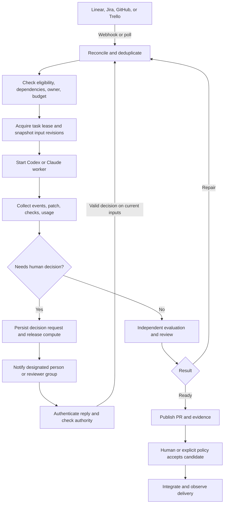

# Outer loop, status updates, and human control

Checked 8 November 2026. This document separates inspected mechanisms from a proposed factory design. Source IDs are in [the companion register](operating-models-sources.md).

## 1. Inner loop versus outer loop

The coding harness's inner loop reads context, calls a model, executes tools, and continues toward a result. The outer loop selects work, dispatches runs, responds to state changes, records evidence, and involves people when needed.

Connecting a tracker through MCP gives a coding agent tools to read and update tasks. It does not by itself create a daemon that wakes up, claims eligible work, retries failures, and manages human waits. A scheduler, workflow runtime, or hosted product must supply those behaviors.

There are also two meanings of “ledger.” A reasoning ledger tracks facts and progress inside one agent workflow. Microsoft's Magentic implementation contains facts/plan records and structured checks for satisfaction, loops, and next speaker. A business work ledger instead identifies tasks, owners, claims, revisions, and acceptance. One is not a substitute for the other. [O19]

## 2. Inspected implementation patterns

### Symphony: reconcile before dispatch

Its specification's polling sequence reconciles running issues, validates configuration, fetches and sorts candidates, dispatches within limits, and updates observability. Claims prevent duplicate dispatch inside its single authoritative scheduler. Failures retry with backoff, and changed issue eligibility can stop work. Restart recovery uses tracker/filesystem state rather than restoring an exact scheduler database. [O02]

The reference workflow's human path is:

```text
Todo -> In Progress -> Human Review -> Merging -> Done
                            |
                            v
                          Rework
```

A single `Codex Workpad` comment carries plan and verification notes. The PR is linked to the issue. `Human Review` is excluded from the sample's active dispatch states, so the service does not need to hold an implementation worker open just to await review. `Merging` signals approval to execute its landing workflow. [O03]

The current implementation also exposes operator-input/approval blocks in runtime status, but documents that this blocked map is in memory. Restarting clears it. This is a concrete gap to test if decisions must remain blocked across restarts. [O04]

### Linear: acknowledge, execute asynchronously, publish activity

An agent-session webhook receiver must respond within five seconds. On a new session, publish an activity or external URL within ten seconds to avoid an unresponsive indication. `created` starts work; `prompted` brings additional human input. Activity drives session status, including `awaitingInput`, `complete`, and `error`. An issue's business state is a separate object. [O06]

Linear also defines a stop signal and elicitation signals for account linking and choices. These provide a usable human interface, while the receiving application still must implement cancellation and authorization correctly. [O07]

### Jira: keep the interaction in the work item

The inspected Copilot integration reads issue description/comments, opens a draft PR, posts progress, and asks clarifying questions in Jira. It preserves the repository's review process. Claude Agent for Jira creates Managed Agent sessions and exposes activity in the item. These are specific integrations, not interchangeable backend implementations. [O11, O12]

### Trello: card-list transitions as commands

Sergio describes polling selected lists every 60 seconds, moving a card into a processing list, publishing planning feedback, and using a separate development lane for a draft PR. PMs and developers can intervene through cards. This is a concrete community implementation, not evidence that Trello itself hosts coding workers. [O14]

### Workflow infrastructure and shared agent services

Microsoft's workflow HITL documentation uses request/response events to wait for external input. Vercel's durable-agent example uses workflow steps around model calls and sandbox execution. These give building blocks for an application-specific dispatcher and decision path. [O20, O26]

Stripe uses code-defined blueprints that mix deterministic steps with agent steps. Running a required linter or pushing a branch can be code-controlled, while implementation remains agentic. The useful design principle is to make obligatory transitions explicit in the runtime. [O42]

## 3. Proposed outer-loop design for this project

The following design is our synthesis, not code copied from a vendor. It can be used to evaluate Symphony, an existing product integration, or a new runtime.



### Polling pseudocode

```text
on_tick:
    reconcile running sessions with tracker state and worker liveness
    reconcile pending decisions and expired leases
    reject invalid configuration for new dispatch
    list candidate tasks in eligible states
    for each candidate in priority order:
        check dependencies, permissions, conflicts, and reserved budget
        atomically acquire a task lease
        record input version, spec version, base commit, and attempt ID
        enqueue worker startup with an idempotency key

on_worker_event:
    deduplicate by event ID and attempt ID
    persist raw event and normalized state
    publish material progress to the human interface
    if input is required:
        persist a decision request before releasing worker capacity
    if a candidate is produced:
        schedule independent validation on that candidate

on_human_response:
    authenticate the responder and check decision authority
    verify the pending request and referenced revisions still match
    record the decision and mark the request resolved
    make the next eligible step dispatchable
```

Webhooks reduce dispatch latency, while periodic reconciliation catches missed events. A small deployment may use polling alone. A distributed dispatcher needs an atomic claim in shared storage; an in-memory set in each of several replicas is insufficient.

Do not use a tracker field as a fragile lock unless the provider supports a suitable conditional mutation or a separate claim record prevents races. Leases need expiry and heartbeats, and workers need fencing so an expired old worker cannot publish over a newer attempt.

## 4. Decide what each status means

Suggested business states:

| State | Meaning | Exit condition |
| --- | --- | --- |
| Backlog | Not admitted for agent execution | Human/team admits scope and priority |
| Ready | Inputs and acceptance sufficient | Scheduler claims an eligible task |
| Working | Active implementation or analysis | Candidate, blocker, failure, or cancellation |
| Needs decision | Durable question assigned to an authorized person | Valid answer or revised scope |
| In review | Candidate and evidence ready | Review accepted or repair requested |
| Integrating | Accepted candidate being checked with current main | Combined candidate succeeds |
| Delivered | Identified build deployed | Operational acceptance check |
| Accepted | Intended outcome verified under the agreed rule | Terminal unless later defect opens new work |

Runtime states should be more precise: queued, starting, running, waiting, interrupted, timed out, failed, cancelled, completed. A failed process can leave a usable patch; a completed process can leave an incomplete business task. Record both.

Assign field ownership. For example, the tracker owns priority and human owner; Git owns code and design versions; the runtime ledger owns attempts and leases; CI owns observed check results. Use IDs and links to connect them instead of duplicating every field bidirectionally.

## 5. How to ask a human for a decision

Persist the request before posting a notification. Proposed record:

```yaml
decision_id: DEC-EXPORT-07
change_id: EXPORT-12
kind: architecture
question: Should an export retry reuse the original export identifier?
options:
  - reuse_existing
  - create_new
recommendation: reuse_existing
reason: avoids duplicate artifacts for the same logical request
required_authority: export_service_design_owner
input_revision: '<spec revision>'
candidate_revision: null
status: awaiting_response
```

The prompt should include the consequence of each option, evidence, and the next action after a decision. The actual authority must map to known people or groups, not a role name that nobody owns.

A comment saying “looks good” is insufficient if several decisions or revisions are pending. Ask the UI to attach the decision ID and current input version. If a newer spec invalidates the question, withdraw the old request instead of accepting a stale answer.

Support reassignment and escalation. A human decision should not require keeping a VM and model session active overnight. Persist context, release compute, and resume through a fresh or continuing session according to the chosen harness.

## 6. Notifications and review evidence

Use the tracker for the authoritative decision and Slack/Teams/email only as configured notification channels. This research did not send any notifications or install integrations.

Proposed notification events:

- A decision blocks work, with a named recipient and direct link.
- A candidate is ready, with the PR, tested revision, check results, and unresolved risks.
- A material failure or exhausted budget needs intervention.
- An accepted or delivered outcome changes what stakeholders can use.

Coalesce routine progress in one status surface. Avoid alerting people for every tool call or retry. A useful progress update says what changed and whether someone needs to act.

Treat review as acceptance of a specific candidate. A review packet should identify the spec/ADR versions, base and head commits, behavioral evidence, automated findings, and remaining uncertainties. New code can invalidate the earlier approval. CI and repository rules should enforce integration requirements even when a tracker says “approved.”

## 7. Multi-agent design and failure cases

Separate these patterns: several independent issue workers, several specialists collaborating on one task, and one worker executing several roles sequentially. Products that support concurrent sessions do not necessarily support peer coordination or shared memory.

Our proposed starting arrangement is a shared queue with one writer per work unit, read-only specialists where useful, a separate evaluator, and a serialized integration queue. Architect and reviewer are roles instantiated when needed. Human owners and reviewers remain attached to the change, not to the lifetime of a worker process.

Test these failure cases before relying on the loop:

1. Duplicate webhook or overlapping poll ticks dispatch the same issue.
2. A worker crashes after opening a PR but before recording it.
3. Human approval arrives after the spec or candidate changes.
4. A user cancels work while an external operation is already in flight.
5. A scheduler restart silently drops a pending decision.
6. A provider session finishes, but its external MCP job continues.
7. Two independently valid branches conflict when integrated.
8. A budget alert arrives too late to prevent already reserved concurrent work.

The [pilot plan](pilot-and-evaluation.md) can be extended with these recovery and human-interaction probes. None were executed by this research.
