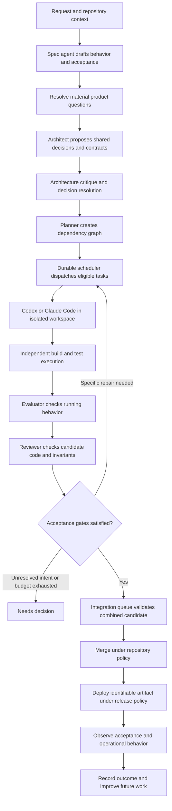

# Proposed reference architecture

This is a design proposal derived from the [research synthesis](ai-software-factory-study.md), not an implemented or benchmarked system. Its central constraint is that a coding agent's completion message cannot, by itself, advance a change to accepted status.

The [human-governed delivery and operations model](human-governed-delivery-and-operations.md) applies this architecture to agent-produced plans/designs, dev/staging deployment, and production troubleshooting, with distinct environment permissions and human decision gates.

The [operating-model follow-up](operating-models-study.md) identifies existing implementations of several responsibilities below, especially Symphony's tracker-driven Codex execution. Evaluate those before implementing a new scheduler. The [outer-loop detail](outer-loop-and-human-control.md) adds decision persistence and multi-human coordination, while [identity and billing](identity-billing-and-team-models.md) distinguishes personal and organization-owned execution.

## Delivery flow



The text path is: capture intent, settle shared design, schedule bounded work, execute, validate behavior, review code, integrate, deliver, and observe. Repairs loop through the same evidence requirements. A consequential requirements change returns to specification instead of becoming an unrecorded implementation choice.

## Components and ownership

| Component | Responsibility | Persistent output |
| --- | --- | --- |
| Intake | Normalize the request, identify task class and affected system | Request record, scope, unresolved questions |
| Specification role | Describe observable behavior and acceptance | Versioned spec and requirement IDs |
| Architecture role | Settle decisions spanning task boundaries | ADRs, interface contracts, failure model |
| Planner | Divide work and identify dependencies and shared resources | Task graph with validation obligations |
| Scheduler | Enforce states, leases, budgets, and permitted transitions | Work ledger and append-only events |
| Coding worker | Implement one work order using a coding harness | Patch or candidate commit and run report |
| Evaluator | Check behavior against independently owned scenarios | Scenario results, traces, reproduction evidence |
| Reviewer | Inspect code and non-obvious invariants | Findings tied to the candidate revision |
| Integrator | Validate the combined result against current main | Integration result and merge candidate identity |
| Release controller | Connect reviewed source to delivered artifact | Build provenance, rollout result, observed outcome |

These are logical roles. The first implementation could use a single worker image with role-specific configurations. It does not need ten services or ten concurrent model sessions. The scheduler can be ordinary application code; agents can propose task changes without directly modifying authoritative state.

## State and event model

Suggested change states:

```text
intake -> specifying -> designing -> ready -> implementing
implementing -> validating -> reviewing -> integration_ready
integration_ready -> integrated -> deployed -> accepted
validating/reviewing -> repair_needed -> implementing
any active state -> needs_decision | failed | cancelled
```

`needs_decision` preserves completed artifacts and the exact unresolved question. A human response, corrected dependency, or amended spec can make work eligible again. Deployment is distinct from acceptance because the running artifact may fail a smoke test or a required observation period.

Suggested events include `spec_version_recorded`, `decision_resolved`, `lease_acquired`, `worker_completed`, `check_failed`, `review_recorded`, `candidate_invalidated`, `integration_passed`, `deployment_observed`, and `outcome_accepted`.

Each event should name the change, task, attempt, actor, timestamp, input revision, and evidence references. Treat an incoming webhook as a notification to reconcile authoritative state. Duplicated or delayed notifications must not schedule duplicate writes or restore an obsolete review result.

For a small pilot, a local database plus an append-only event log and artifact directory is sufficient. If later adopting a graph runtime, distinguish its checkpoints from the factory's work ledger. LangGraph documents checkpoints and cross-thread stores, but the application still needs meaningful task and artifact identities. [S21](sources.md#s21-langgraph-persistence)

## Work-order contract

Illustrative YAML, independent of any vendor SDK:

```yaml
task_id: EXPORT-04
attempt_id: EXPORT-04-a1
role: implementer
repository: example/application
base_commit: '<resolved commit SHA>'
spec_revision: '<resolved specification revision>'
requirements: [REQ-EXPORT-01, REQ-EXPORT-03]
architecture_decisions: [ADR-EXPORT-02]
depends_on: [EXPORT-01]
writable_paths:
  - src/export/
  - tests/export/
protected_paths:
  - acceptance/holdout/
  - factory/policies/
verification:
  - '<repository-defined focused test command>'
  - '<repository-defined contract test command>'
limits:
  wall_time_minutes: 30
  max_repair_attempts: 2
completion:
  artifact: candidate_commit
  report: worker-result.json
```

The numbers are proposed pilot limits, not defaults from a product. Supply monetary limits from the pilot budget and enforce them in the scheduler. Populate real verification commands after inspecting the implementation repository.

Enforce writable scope with filesystem or container boundaries where feasible and inspect the final diff. A prompt is useful guidance but cannot enforce a permission boundary. Validators, review rules, and holdout cases should have owners outside the implementation role.

## Worker result contract

Proposed normalized result shape:

```json
{
  "task_id": "EXPORT-04",
  "attempt_id": "EXPORT-04-a1",
  "base_commit": "<SHA>",
  "candidate_commit": "<SHA>",
  "spec_revision": "<revision>",
  "status": "candidate_ready",
  "requirements_addressed": ["REQ-EXPORT-03"],
  "checks": [
    {
      "command": "<actual command>",
      "exit_code": 0,
      "log_artifact": "<artifact reference>"
    }
  ],
  "known_issues": [],
  "session_reference": "<provider session ID>",
  "usage_reference": "<usage artifact>"
}
```

The scheduler validates the output schema, task identity, and referenced artifacts. The validation runner independently verifies the patch. A process exit code of zero is evidence that the process completed successfully, not proof that the requested behavior exists.

Record provider-specific raw events alongside normalized events. Preserve unknown usage fields rather than silently treating missing data as zero. A resumed provider session may report cumulative usage; account for attempt deltas without double counting.

## Architecture design protocol

Give the architecture role the spec, repository map, existing decisions, and relevant operational evidence. Require:

1. A context and dependency map showing affected components and external systems.
2. Data ownership, invariants, and where state transitions occur.
3. API or event contracts including failures, compatibility, retries, and idempotency.
4. Alternatives for consequential decisions with evidence and trade-offs.
5. Migration and rollback implications where applicable.
6. Checks or experiments that could disprove the proposed design.

The critique pass should look for incompatible assumptions, hidden shared state, partial failure, concurrency, missing authorization checks, and an untestable acceptance definition. It should not create alternative architecture merely to satisfy an arbitrary quota of findings.

An ADR should record context, considered alternatives, decision, consequences, and validation. Link task IDs to the relevant ADR. If implementation disproves an assumption, amend or supersede the decision and invalidate affected downstream work.

For example, an export API may require a decision on whether retries create duplicate exports. That choice affects storage constraints, request identifiers, worker retries, API responses, and tests. Settle it before assigning API and background-worker tasks independently.

## Review and evaluation protocol

Run the evaluator against a built candidate identified by commit and artifact digest. Give it scenarios based on the approved spec. For UI work, inspect actual interaction and persisted state, not only screenshots. For API work, include negative cases and contract compatibility. Add performance checks only against an explicit workload and target.

Give the code reviewer the candidate diff and surrounding code. Findings should contain:

- Severity and a concrete failure condition.
- File and line or another precise artifact location.
- The violated requirement, decision, or invariant.
- Supporting trace, reproduction, or code path.
- The smallest useful repair direction and any uncertainty.

Deduplicate findings and challenge suspected false positives. Mechanical formatting belongs in automated checks. No-findings output should be recorded as a review result, not upgraded into proof of correctness.

Require a new review when candidate code changes. Reusing evidence is safe only where the validation system can establish that its inputs are unchanged. For the pilot, rerunning affected checks is simpler than building a sophisticated evidence cache.

## Parallel execution and integration

Use one isolated worktree or clone per writer and an exclusive lease per work order. Worktrees isolate edits but share Git machinery and possibly other local resources; stronger execution isolation needs containers or equivalent boundaries. Assign explicit ownership for shared contracts, migration sequences, generated files, ports, databases, and lockfiles.

Serialize changes to a shared interface unless consumers work against a committed compatible contract. If two branches pass independently, validate their combined candidate before merge. After rebasing onto a changed main branch, invalidate obsolete evidence and run checks against the new candidate.

Begin with two-worker experiments only after the single-writer path works. Parallel reviewers may be useful earlier because they do not contend for write ownership.

## Recovery and stopping

Persist checkpoints at task boundaries containing the accepted input versions, candidate revision, completed checks, open findings, remaining budget, and next action. On worker loss, expire its lease, reconcile produced artifacts, and dispatch a new attempt. Do not blindly replay actions that may already have completed.

Use bounded repair attempts. If the same failure persists, return a concise diagnostic and the evidence needed for a decision. A passing evaluator must not override exhausted budget or unresolved blocking findings. A person or an explicit repository policy can decide how the work proceeds.

Merge and deployment operations need idempotency and reconciliation of actual remote state. A crash after a successful operation must not cause the workflow to claim it failed and repeat it without checking.

## Proposed repository layout

```text
docs/specs/<feature>/spec.md        current behavior and requirement IDs
docs/architecture/adr-*.md         consequential shared decisions
changes/<change-id>/proposal.md    change intent and rationale
changes/<change-id>/tasks.yaml     task dependencies and obligations
factory/roles/                    versioned worker role definitions
factory/schemas/                  work-order and result contracts
factory/policies/                 scheduler and acceptance policy
acceptance/                       independently owned public scenarios
```

Keep private holdout cases in a separately controlled location when needed. Keep bulky run logs and secrets out of ordinary Git history; store artifacts with access control and retention, and commit durable references where useful. Back up the work ledger and artifacts separately from source control.

This research adds documentation only. The layout above describes a possible implementation, not directories created or tooling installed by this task.
